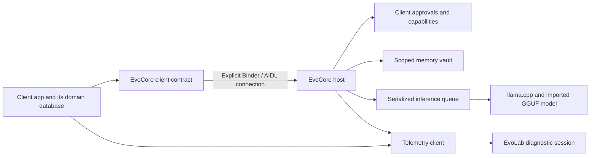

# Evo Android

A local-first Android prototype for sharing one on-device AI host across several applications.

EvoCore owns model inference, access approvals, and scoped memory. Client apps keep their domain data and send a small, expiring context for the current task. This repository brings the host, client contract, sample app, EvoConti, and EvoLab into one Gradle project.

**Status: in development.** The repository contains experimental Android applications, not a production release. Existing version numbers describe the source modules; they do not establish release readiness or a verified result on your device.

## What is here

| Module | Purpose |
| --- | --- |
| `evocore-host` | EvoCore application: local inference, client approval, scoped memory, model import, and access management. |
| `evocore-contract` | Java client SDK, AIDL interfaces, protocol negotiation, context envelopes, request events, and typed tool contracts. |
| `evocore-sample-client` | Small task app demonstrating connection states, streaming, cancellation, and proposals that require confirmation. |
| `app` | EvoConti: a personal finance and shopping prototype with domain logic, local storage, and an EvoCore gateway. |
| `evocore-telemetry` | Shared telemetry protocol and collection client. |
| `evolab` | EvoLab / EvoDashboard: local diagnostic sessions, charts, and device sampling. |
| `llamaLib` | Kotlin/JNI bridge and Android native build integration for the vendored `llama.cpp` sources. |

`third_party/llama.cpp` contains the native inference dependency and its upstream license materials. Other proposed Evo apps are not implemented modules in this repository.

## How it fits together



The current implementation uses:

- A signature permission for the host service, with additional caller and manifest checks. A host and its client apps must be signed with the same certificate.
- A visible client approval registry and capability checks for inference, memory, status, and tool proposals.
- Memory scopes based on the client package and namespace, with an AES-GCM vault backed by Android Keystore.
- Protocol v3 request events and cancellation, with compatibility support for protocol v2.
- Structured `ContextEnvelope` payloads with a schema, expiry, and size limit. The convenience screen builder gives context a five-minute lifetime.
- Typed tools in `READ` or `PROPOSE` mode. The client app confirms and applies a proposed change; the model does not directly write to its database.
- A single inference queue and idle model unloading in the host.

Local model inference does not require an OpenAI API key or a hosted model service. Some EvoConti features make network requests for product, book, or financial information. Local inference does not mean that every application feature is offline.

## Build from source

Open the repository root in Android Studio, or browse it in VS Code and build with the Gradle wrapper.

### Toolchain

| Component | Configuration |
| --- | --- |
| Java | JDK 17 or a newer JDK compatible with Gradle 8.10.2; source and bytecode targets are Java 17. |
| Gradle | 8.10.2 through the repository wrapper. |
| Android Gradle Plugin | 8.7.3. |
| Kotlin Android plugin | 2.1.0. |
| Android SDK | Compile and target API 35; minimum API 26. |
| Android NDK | `29.0.13113456`. |
| CMake | `3.31.6`. |
| Native ABIs | `arm64-v8a` and `x86_64`. |

Install the SDK packages with Android Studio's SDK Manager or the Android command-line tools:

```sh
sdkmanager "platform-tools" "platforms;android-35" "ndk;29.0.13113456" "cmake;3.31.6"
```

Set your SDK location through Android Studio, an `ANDROID_HOME` environment variable, or an untracked `local.properties` file containing `sdk.dir`. Accept the SDK licenses when prompted. Gradle downloads its dependencies, and the ARM native build can fetch KleidiAI through CMake, so the first build needs network access.

Clone and build:

```sh
git clone https://github.com/atlas-devlab/evo-android.git
cd evo-android
./gradlew -PbuildNativeLlama=true :evocore-host:assembleDebug :app:assembleDebug :evocore-sample-client:assembleDebug :evolab:assembleDebug
```

On Windows PowerShell, use `./gradlew.bat` in place of `./gradlew`.

The public checkout builds the JNI libraries from source. Keep `buildNativeLlama=true`; prebuilt native libraries are not distributed in this repository. APKs are written under each application's `build/outputs/apk/debug/` directory. EvoCore and EvoConti produce separate APKs for the configured ABIs.

### Run a development build

1. Choose an Android API 26+ emulator or device with a supported ABI.
2. Install the matching EvoCore APK, then install EvoConti or the sample client from the same checkout and signing environment.
3. Open the client once, then approve it in EvoCore's **Accessi** (Access) screen and reconnect.
4. For model-backed inference, import a compatible GGUF through **Importa modello GGUF** (Import GGUF model) in EvoCore. The host copies it into its own private application storage.
5. Install EvoLab if you want to inspect a diagnostic session.

The interface and much of the existing client documentation are currently in Italian. A model file is not bundled in the APKs or repository. Obtain a model separately under its own license, choose one that fits the device, and verify its compatibility with the vendored runtime. Model format alone does not guarantee compatibility.

Debug builds made on different machines can have different signing certificates. Rebuild the host and clients together when testing the signature-protected connection; do not weaken the permission to work around a certificate mismatch.

## Validation

The source includes JVM tests and Android instrumentation tests. See the
[validation record](docs/VALIDATION.md) for the checks completed on this source
snapshot and their limits. Run the relevant checks again for your checkout.

```sh
./gradlew -PbuildNativeLlama=false :app:testDebugUnitTest :evocore-host:testDebugUnitTest :evocore-contract:testDebugUnitTest :evocore-telemetry:testDebugUnitTest :evolab:testDebugUnitTest
./gradlew -PbuildNativeLlama=true :app:lintDebug :evocore-host:lintDebug :evocore-contract:lintDebug :evocore-sample-client:lintDebug :evocore-telemetry:lintDebug :evolab:lintDebug :llamaLib:lintDebug
```

The JVM command disables JNI compilation for isolated unit tests. Application
builds and native/device validation use `buildNativeLlama=true`.

Instrumentation requires an explicit emulator or device and may require installed companion apps, matching signatures, approvals, or an imported model. Inspect the relevant test before running it. For example, the host's Android test suite is invoked with:

```sh
./gradlew -PbuildNativeLlama=true :evocore-host:connectedDebugAndroidTest
```

Native compilation and model execution are distinct checks. A successful APK build alone does not demonstrate inference quality, acceptable latency, memory use, or device compatibility.

## Explore the code

- Start with the [sample client](evocore-sample-client/src/main/java/it/evocore/sample/MainActivity.java) to follow a complete request and proposal flow.
- Read [EvoCoreClient](evocore-contract/src/main/java/it/evocore/client/EvoCoreClient.java) and the [AIDL service](evocore-contract/src/main/aidl/it/evocore/client/IEvoCoreService.aidl) for the client boundary.
- Follow the [host service](evocore-host/src/main/java/it/evocore/host/EvoCoreService.java) for request validation and lifecycle.
- Read the [client integration guide](docs/EVOCORE_CLIENT_KIT.md) for the current protocol and integration examples. The guide is currently in Italian.

## Contribute

Contributors are welcome. You can [open an issue](https://github.com/atlas-devlab/evo-android/issues), fork the repository, and send a pull request with a focused improvement. Documentation, accessibility, localization, tests, and client examples are useful starting points.

See [CONTRIBUTING.md](CONTRIBUTING.md) for setup, review expectations, and three suggested starter tasks.

## Related Evo project

[EvoCall Assistant](https://github.com/atlas-devlab/evo-call-assistant) is a
separate Windows/Python conversation assistant prototype. It is published under
Apache 2.0 and welcomes contributions. It is not an Android module or an EvoCore client.

## License and third-party code

Original project code is licensed under [Apache License 2.0](LICENSE). Vendored dependencies retain their own licenses, including the [MIT license for llama.cpp](third_party/llama.cpp/LICENSE) and the notices supplied with its dependencies.

The public source distribution excludes GGUF files, including upstream vocabulary/test fixtures, and prebuilt native binaries. Android inference libraries are compiled from the included sources. Some standalone upstream `llama.cpp` tests therefore need fixtures obtained separately from upstream; those tests are outside the Android Gradle checks above.

Model weights are not included and are not covered by the project's Apache license. Follow the license of the model you choose.
