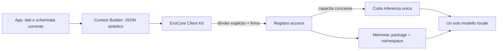

# EvoCore Client Kit

## La regola in una frase

Ogni app conserva i propri dati e descrive a EvoCore solo il contesto sintetico del momento; EvoCore conserva un solo modello, una memoria separata per app e concede capacita solo dopo approvazione.

Non si copia Gemma nelle nuove APK. Non si condivide il database di un'app con un'altra. Non si abbassa mai il permesso Binder da `signature` a `normal` o `dangerous`.

## Cosa viene installato

1. `EvoCore.apk` una volta sola: modello, inferenza, memoria cifrata, policy, registro accessi.
2. `evocore-contract.aar` dentro ogni app: client leggero, AIDL e diagnostica.
3. Le app come EvoConti, EvoAgenda o EvoSalute: UI, database e logica del proprio dominio.
4. Un solo file GGUF importato in EvoCore, riusato da tutte le app autorizzate.



## Collegare una nuova app

### 1. Usa la stessa chiave di firma

EvoCore e le tue app private devono essere firmate con lo stesso certificato di rilascio. In sviluppo le build debug create sulla stessa macchina usano normalmente lo stesso debug keystore. Per la distribuzione va conservata una sola release key privata e va usata nella pipeline di tutte le tue APK.

Una APK firmata da un altro servizio non puo collegarsi al canale privato. Non e un errore: e il primo confine di sicurezza.

### 2. Aggiungi il contratto

```gradle
dependencies {
    implementation files("libs/evocore-client-kit-v3-debug.aar")
}
```

Il manifest della libreria aggiunge gia il permesso e la visibilita del package Host.

### 3. Dichiara la carta d'identita

Nel nodo `<application>` del manifest della nuova app:

```xml
<meta-data
    android:name="it.evocore.client.ID"
    android:value="evoagenda" />
<meta-data
    android:name="it.evocore.client.NAMESPACE"
    android:value="principale" />
<meta-data
    android:name="it.evocore.client.CAPABILITIES"
    android:value="inference.ask,memory.read,memory.write,memory.manage,status.read,tools.propose" />
```

`client.ID` e un nome stabile dell'app. `NAMESPACE` separa eventuali profili della stessa app. La vera chiave della memoria e sempre `packageName:namespace`, quindi due app che usano entrambe `principale` non condividono nulla.

Richiedi solo le capacita necessarie:

| Capacita | Uso |
|---|---|
| `inference.ask` | Dialogo e analisi del contesto |
| `memory.read` | Recupero dei ricordi privati dell'app |
| `memory.write` | Nuovi ricordi proposti o espliciti |
| `memory.manage` | Dimenticare i propri ricordi; conferma e correzione restano nella UI EvoCore |
| `status.read` | Stato del motore e diagnostica |
| `tools.propose` | Strumenti tipizzati `READ` e `PROPOSE`, mai scritture autonome |

### 4. Connetti il client

```java
EvoCoreClient core = EvoCoreClient.fromManifest(context, (ready, detail) -> {
    // Aggiorna un indicatore nella UI; non bloccare il thread principale.
});
core.connect();
```

Alla prima apertura la nuova app compare in `EvoCore > Accessi` come `DA APPROVARE`. Dopo l'approvazione, richiama `core.connect()`; non serve reinstallare nulla.

Per aprire direttamente la gestione accessi:

```java
EvoCoreClient.openAccessManager(context);
```

### 5. Invia solo il contesto della funzione corrente

Esempio per un'agenda:

```json
{
  "schema": "evoagenda.screen.v1",
  "screen": "settimana",
  "now": "2026-07-17T16:30:00+02:00",
  "events": [
    {"id": "local-17", "title": "Dentista", "startsAt": "2026-07-18T10:00:00+02:00"}
  ],
  "freeMinutes": 90,
  "userSelectedEventId": "local-17"
}
```

Non inviare l'intero database, token, password, immagini grezze o dati di altre app. Per un'immagine si inviano il risultato locale strutturato e, solo se serve davvero, un riferimento temporaneo con consenso.

### 6. Gestisci gli stati, non una generica eccezione

| Stato | Cosa mostra l'app |
|---|---|
| `NOT_INSTALLED` | Installa EvoCore |
| `UNTRUSTED_HOST` | Non inviare dati: la firma dell'Host non coincide |
| `PAIRING_REQUIRED` | Apri Accessi e approva questa app |
| `READY` | Motore disponibile |
| `REVOKED` | Accesso revocato; apri EvoCore |
| `INCOMPATIBLE` | Aggiorna Host o Client Kit |
| `ERROR` | Mostra diagnostica e usa il fallback locale del dominio |

## Protocollo v3: contesto, eventi e strumenti

Il client v3 invia un `ContextEnvelope` con schema, schermata, sensibilita e scadenza. Il contesto creato con `ContextEnvelope.screen(...)` scade dopo cinque minuti: EvoCore non deve ragionare su una schermata ormai vecchia.

La risposta non e piu un solo blocco opaco. Il client riceve eventi ordinati:

`ACCEPTED -> STARTED -> TEXT_DELTA/TOOL_CALL -> FINAL`

Una richiesta termina una sola volta con `FINAL`, `ERROR` oppure `CANCELLED`. Il relativo `RequestHandle` permette di annullarla e di osservare l'evento terminale.

```java
ToolDescriptor count = new ToolDescriptor(
        "evoagenda.events.count",
        1,
        ToolDescriptor.MODE_READ,
        "Conta gli eventi visibili",
        "{\"type\":\"object\"}",
        "{\"type\":\"object\"}",
        List.of("quanti eventi", "conta gli eventi"),
        false,
        5_000L,
        4_096);

ToolRegistry tools = new ToolRegistry().register(count, call -> {
    int total = agendaRepository.visibleCount();
    return ToolResult.success(call, "{\"count\":" + total + "}");
});

ContextEnvelope screen = ContextEnvelope.screen(
        "evoagenda.week.screen.v1",
        "week",
        contextBuilder.currentWeekJson());

EvoCoreClient.RequestHandle request = core.submit(
        screen,
        question,
        "assistant",
        "evoagenda.week",
        30_000L,
        tools,
        ContextCompat.getMainExecutor(context),
        event -> renderEvoCoreEvent(event));
```

Gli strumenti ammessi in v3 sono:

| Modalita | Regola |
|---|---|
| `MODE_READ` | Legge un dato ristretto dalla funzione corrente |
| `MODE_PROPOSE` | Restituisce una proposta strutturata senza salvarla |
| `MODE_EXECUTE` | Rifiutata dal Client Kit e dall'Host v3 |

Per una proposta, l'app mostra il risultato, chiede conferma, valida di nuovo i parametri e solo allora scrive nel proprio database. Il `ToolResult` deve mantenere `requestId`, `callId` e `toolId` originali e non puo dichiarare effetti gia eseguiti.

Se l'Host supporta soltanto v2, il Client Kit adatta la richiesta al vecchio metodo `ask`; streaming, annullamento e strumenti tipizzati richiedono invece il protocollo v3.

## Perche non si creano conflitti

| Possibile conflitto | Regola EvoCore |
|---|---|
| Due app si chiamano uguale | Android identifica il `packageName`, non l'etichetta visibile |
| Due app dichiarano lo stesso namespace | Lo scope include anche il package |
| Una app chiede nuovi permessi dopo un aggiornamento | Torna automaticamente `DA APPROVARE` |
| Una app viene revocata mentre ha una sessione | Ogni chiamata ricontrolla il registro persistente |
| Due app interrogano il modello insieme | Una coda Host serializza l'inferenza; ogni richiesta ha la propria sessione |
| Il processo Host muore | Il client si riconnette e apre una nuova sessione |
| Versioni diverse | Handshake v3 negozia l'intervallo e rifiuta chiaramente versioni incompatibili |
| App contraffatta con lo stesso package | Firma e UID vengono verificati dal sistema e nuovamente a runtime |
| Memoria condivisa per errore | Privata per default; la condivisione futura richiedera una promozione esplicita |

## Esempi di app intelligenti

| App | Database proprietario | Contesto inviato | Memoria EvoCore | Capacita minime |
|---|---|---|---|---|
| EvoConti | movimenti, budget, debiti | mese e schermata finanziaria attiva | stile, obiettivi, decisioni confermate | ask, read, write, manage, status |
| EvoAgenda | eventi e promemoria | intervallo visibile, conflitti e selezione | preferenze orarie | ask, read, write, status |
| EvoSalute | diario e misure | riepilogo autorizzato, mai cartella grezza | routine confermate e sensibilita temporanee | ask, read, write, manage |
| EvoDispensa | prodotti e scadenze | lista sintetica e pasto corrente | gusti e allergie confermate | ask, read, write |
| EvoStudio | materie, sessioni e quiz | lezione aperta e progressi aggregati | metodo di studio e difficolta | ask, read, write, manage |
| EvoCasa | dispositivi e scene | stato dei soli dispositivi selezionati | preferenze ambientali | ask, read, status |
| EvoViaggi | itinerari e prenotazioni | tappa corrente e vincoli | stile di viaggio | ask, read, write |
| EvoDiario | note e check-in | pagina o tema scelto | fatti esplicitamente promossi | ask, read, write, manage |

Le azioni reali restano tipizzate nell'app: il modello puo proporre `crea_promemoria`, ma l'app valida parametri, mostra conferma, esegue in modo idempotente e verifica il risultato.

## Prompt da dare al generatore di una nuova app

```text
Questa app e un client di EvoCore. Non includere modelli GGUF, llama.cpp o una memoria personale duplicata.
Mantieni il database di dominio dentro l'app. Integra evocore-client-kit-v3-debug.aar e dichiara nel manifest
client ID, namespace e il minimo insieme di capability. Crea un ContextBuilder per ogni schermata
che produca un ContextEnvelope sintetico, versionato e a scadenza. Usa EvoCoreClient.fromManifest(),
gestisci gli eventi terminali, l'annullamento e tutti gli stati di connessione. Conserva un fallback
deterministico locale. Esponi soltanto tool READ o PROPOSE; non eseguire automaticamente azioni
proposte dal modello: valida, chiedi consenso, esegui con API tipizzate, idempotenti e verificabili.
L'APK deve essere firmata con la stessa release key di EvoCore.
```

## Modelli da cui prendiamo le idee giuste

- [Health Connect architecture](https://developer.android.com/health-and-fitness/health-connect/architecture): un APK centrale, SDK client, IPC e gestione permessi visibile per ogni app.
- [Android AppFunctions](https://developer.android.com/ai/appfunctions): futura esposizione di funzioni tipizzate delle app agli agenti Android; a maggio 2026 e ancora sperimentale e l'integrazione completa con Gemini e in preview privata.
- [Android signature permissions](https://developer.android.com/privacy-and-security/risks/access-control-to-exported-components): il servizio esportato sensibile e accessibile solo alle app dello stesso sviluppatore.
- [Android bound services](https://developer.android.com/develop/background-work/services/bound-services): connessione esplicita e ciclo di vita del servizio legato ai client.
- [MCP architecture](https://modelcontextprotocol.io/specification/2025-06-18/architecture): handshake, negoziazione delle capacita, sessioni isolate e Host come punto di consenso.
- [Apple App Intents](https://developer.apple.com/documentation/appintents): azioni e oggetti dell'app esposti in forma strutturata, non accesso libero al suo database.
- [Home Assistant integration manifest](https://developers.home-assistant.io/docs/creating_integration_manifest/): identita stabile, dominio univoco, dipendenze e caratteristiche dichiarate.

EvoCore non copia integralmente nessuno di questi sistemi: usa le parti compatibili con un agente Android privato e locale.

## Checklist prima di una nuova APK

- Package Android unico.
- Stessa release key di EvoCore.
- Verifica positiva di `EvoCoreClient.isTrustedHost()` prima di inviare contesto.
- Client ID stabile e namespace dichiarato.
- Solo capability necessarie.
- Nessun modello o runtime nativo dentro la client APK.
- `ContextEnvelope` sotto 96 KiB, con `schema` versionato e scadenza breve.
- Nessun database grezzo nel payload.
- Solo strumenti `READ` o `PROPOSE`; le scritture restano nel client dopo conferma.
- Gestione esplicita di `FINAL`, `ERROR`, `CANCELLED` e `RequestHandle.cancel()`.
- Fallback locale se EvoCore e assente o occupato.
- Schermata diagnostica con stato EvoCore.
- Test: pairing, revoca, aggiornamento capability, morte del processo, due app simultanee e isolamento memoria.

## App firmate da una chiave diversa

La versione attuale le rifiuta intenzionalmente. Il passo futuro corretto e un `EvoCore External Bridge` separato, con consenso per singola richiesta, payload ancora piu ristretto e nessun accesso diretto al caveau. Non va risolto rendendo pubblico il servizio principale.
